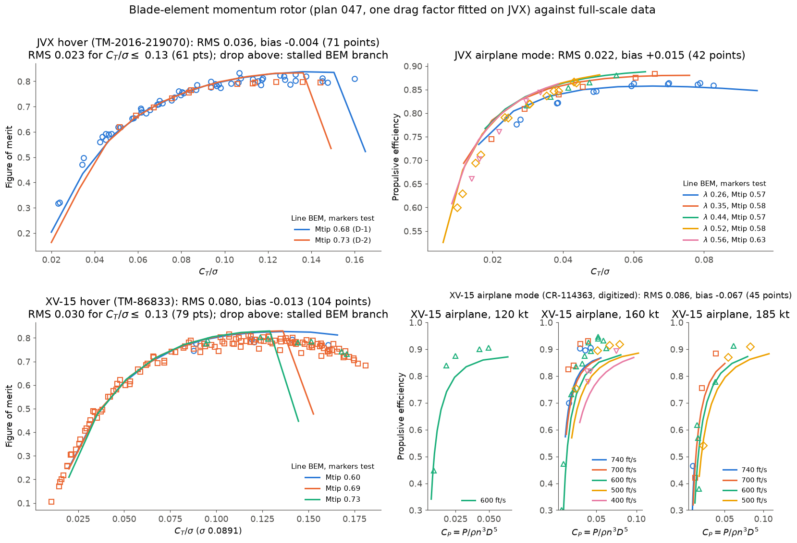

# Plan 052: BEM performance curves against full-scale JVX and XV-15 data, hover and airplane mode

Status: COMPLETED 2026-10-11.

## Goal

Plan 047 checked the blade-element momentum rotor (`rotor_bemt`) against JVX point by point. This plan draws the
BEM as continuous performance curves over the test data, in the form the reports plot them, and adds the XV-15 as
an independent check. The drag factor stays at the JVX fit (0.964), so the XV-15 results are predictions.

## Data added (`data/rotors/`)

- `xv15_hover.csv`: NASA/TM-86833 (Felker, Betzina, Signor, 1985). The full-scale XV-15 metal-blade rotor
  hovering at the Ames OARF.
  - Appendix A was transcribed by hand from the scanned tables; the PDF's OCR layer is unreadable.
  - 160 points from runs 14-16 and 22-24: 136 at Mtip 0.69, 7 at 0.60 and 8 at 0.73. Runs 25-26 had the wake rake
    installed and 2-3.5 m/s winds, and are not included.
  - Columns kept: tip speed, Mtip, collective, wind, density, C_T/sigma and the wind-corrected FM.
- `xv15_airplane.csv`: NASA CR-114363 (Bell, 1971). The 25-ft Bell Model 300 proprotor (the XV-15 rotor) in
  airplane mode in the Ames 40x80.
  - 46 points digitized by eye from figures IV-33 to IV-35, at 120, 160 and 185 kt and 400-740 ft/s tip speed.
  - The figures give efficiency against the propeller power coefficient C_P = P / (rho n^3 D^5), with J = V/(nD).
  - Reading accuracy is about +/-0.001 in C_P and +/-0.5 points in efficiency. These are the only public XV-15
    airplane-mode performance data found.

## XV-15 blade (`examples/proprotor_bemt_curves.py`, `xv15_rotor`)

| Parameter | Value | Source |
|---|---|---|
| Radius, blades | 150 in, 3 | TM-86833 Table I |
| Chord | 14 in, root cuff 16.6 in at 0.091 R tapering to 14 in at 0.25 R | CR-114363 Table III-1 (cuff 17 in at 0.0875 R), TM-86833 fig. 7 |
| Thrust-weighted solidity | 0.0890 (test: 0.0891) | model |
| Twist | Digitized from TM-86833 fig. 5: +29.7 deg at 0.10 R, 0 at 0.77 R, -5.1 deg at 0.95 R; tip extrapolated to -6.3 deg (about 36 deg over the blade, nonlinear) | fig. 5 |
| t/c | 0.32 at 0.09 R, 0.28 at 0.17 R, 0.185 at 0.51 R, 0.125 at 0.80 R, 0.082 at the tip | fig. 6 |
| Root cutout | 0.09 R | first airfoil station, fig. 8 |
| Sections | plan 047 family: one NACA 64A210 camber line with the thickness scaled | assumption |

**The section assumption is the main gap.** The real blade runs from a NACA 64-935 root (design lift coefficient
0.9) to a 64-208 tip, so its inboard sections carry far more camber than the model's.

## Method

- **Sweep.** Each test condition (fixed tip speed, inflow and air) is swept over the thrust range of its data, on
  9-11 thrust points.
- **Continuation.** The sweep starts at 60 % of the range with the stepped solve and continues up, then down, from
  the neighbouring solution: a fixed list of starting points, not an iteration.
- **Rejection.** Solutions above the momentum limit, and failed solves, are dropped.
- **Error.** Each measured point is compared with the curve interpolated at its own C_T/sigma (hover and JVX
  airplane mode) or C_P (XV-15 airplane mode). No extra solves are needed.
- **Run time.** The four groups are cached separately to `output/proprotor_bemt_curves_<group>.pkl` and run in
  parallel in about 6 minutes, single-threaded:

      python examples/proprotor_bemt_curves.py <group>... --sweep-only
      python examples/proprotor_bemt_curves.py --cached

## Results

| Case | Points | RMS | Bias (BEM - test) |
|---|---|---|---|
| JVX hover, all | 71 | 0.036 | -0.004 |
| JVX hover, C_T/sigma <= 0.13 | 61 | 0.023 | -0.003 |
| JVX airplane mode, 5 advance ratios | 42 | 0.022 | +0.015 |
| **XV-15 hover, C_T/sigma <= 0.13** | 79 | **0.030** | +0.012 |
| XV-15 hover, all | 104 | 0.080 | -0.014 |
| **XV-15 airplane mode** | 45 | **0.086** | **-0.067** |

- **JVX.** The curves reproduce plan 047's point-by-point numbers (hover 0.018-0.040, airplane mode 0.025), as
  they should.
- **XV-15 hover is predicted well up to C_T/sigma 0.13.** The curve follows the data from FM 0.2 to 0.8, about
  0.01-0.03 optimistic near the FM peak.
- **Above C_T/sigma 0.13 to 0.14, every BEM hover curve drops onto a stalled branch.** XV-15 at Mtip 0.69 and
  0.73, and JVX at both tip Machs, while the data stay near FM 0.72-0.80 up to C_T/sigma 0.18.
  - This is the same failure plan 047 found at the two highest-thrust JVX points, now seen on a second rotor.
  - The inboard sections stall in the model and not in the test. Likely causes: the 2-D NeuralFoil stall on one
    lightly cambered section family, and a stall-delay model that is too weak.
  - **This bears directly on plan 047's finding that the 0.060-solidity Halo blade has no attached hover solution
    at C_T/sigma 0.14.** That result sits in the band where the BEM is now shown to be conservative against two
    full-scale rotors.
- **XV-15 airplane mode: the BEM is about 0.07 low against the 1971 data,** largest at J 1.21-1.41 (up to 0.19).
  - The curve shapes and the tip-speed ordering are right.
  - Bell's own calculated curves in the same figures are also below the data. The BEM lands close to them and
    slightly lower.
  - The data scatter by about +/-0.04, and several points read 0.93-0.95, close to the momentum limit.
  - The JVX airplane-mode data (2016, better instrumented) agree with the BEM within 0.022. The 1971 XV-15
    numbers are therefore the weaker evidence. The likely contributors are the inboard camber gap, an unmodelled
    hub/spinner force convention in "propulsive force", and the reading error.

## Tests

`tests/integration/test_xv15_bemt.py` (4 tests, about 25 s):

- the data files load;
- the geometry reproduces the 0.0891 solidity;
- hover FM at C_T/sigma 0.10, Mtip 0.69, is within 0.04 of the test mean;
- an airplane-mode point at 160 kt and 600 ft/s trims above 0.75 efficiency and below the momentum limit.

`tests/integration/test_jvx_bemt.py` still passes.

## Next

1. **High-thrust hover.**
   - Calibrate or replace the stall-delay model so the hover curves stay attached to C_T/sigma 0.18 on both rotors,
     e.g. Du-Selig or Corrigan-Schillings in place of the saturated Snel factor.
   - Then re-run plan 047's Halo blade solidity finding before the reference solidity floor is changed.
2. **XV-15 sections.** A per-station camber schedule (64-935 to 64-208) would test whether the airplane-mode deficit
   and the high-thrust stall come from the camber gap.
3. **Better XV-15 airplane-mode data.** If a tabulated source turns up, replace the digitized figures:
   - the 1978 complete-aircraft 40x80 test;
   - the TTR / NFAC entries.
