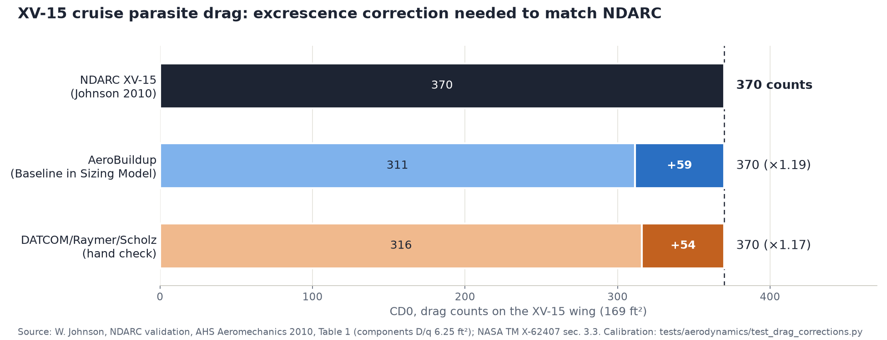
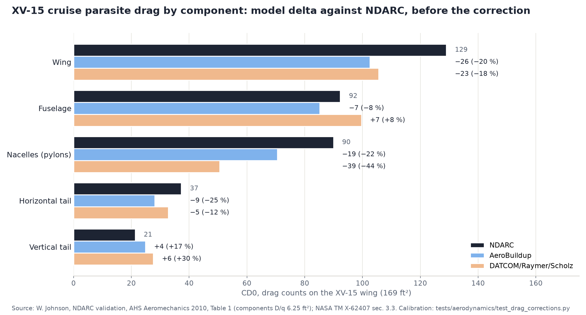

# Plan 054: baseline v3.9, the XV-15 drag calibration redone on the published geometry, fully turbulent

## Goal and scope

Plan 034 calibrated an excrescence factor so the AeroBuildup and Scholz build-ups match the NDARC XV-15 component
drag (6.25 ft2: wing, tails, fuselage, pylons). AeroBuildup needed 1.27, a large markup. The author asked whether
the XV-15 geometry inputs were right. Several were not: the wing section (NACA 2423 for a 64A223), the horizontal
tail section, an assumed 9 x 3.3 ft nacelle, a round fuselage, and 10 % laminar flow on surfaces that sit in the
proprotor slipstream.

In: the XV-15 drag geometry from the published sources, the transition setting, the recalibrated factors, a
re-sized baseline (v3.9) and figures. Out: the twin vertical fins (modelled as one fin of the total area; that
component already reads 15 % high), the main-gear sponsons, and any change to the Halo's own wing section.

## References

- W. Johnson, "NDARC - NASA Design and Analysis of Rotorcraft Validation and Demonstration", AHS Aeromechanics 2010,
  Table 1: XV-15 cruise D/q 9.25 ft2 = wing 2.18, fuselage 1.56, pylons 2 x 0.76, horizontal tail 0.63, vertical
  tail 0.36, fittings and fixtures 3.00.
- NASA TM X-62407 (1975), XV-15 Familiarization Document, sec. 3.3 (wing 169 ft2, 32.17 ft between rotor
  centrelines, NACA 64A223; horizontal tail 50.25 ft2, NACA 64A015; vertical tails 2 x 25.25 ft2, NACA 0009 mod,
  31.6 deg sweep) and fig. 3.5.1 (cabin sections).
- XV-15 dimensioned three-view (Bell / NASA SP-4517): 35 ft 2 in across the nacelles and 32 ft 2 in between rotor
  centrelines (nacelle width 3.0 ft), nacelle depth 3 ft 2 in (front view), nacelle length about 12.5 ft scaled
  from the plan and side views.
- NeuralFoil (via AeroSandbox): free-transition (e^N) section polars; AeroSandbox UIUC ordinates of the NACA 64A210
  and 64A010.

## Model

- **`build_xv15_drag_aircraft`** (`examples/xv15_reference.py`): the XV-15 used only for the drag calibration.
  Wing NACA 64A223 (the 64A210 camber line with thickness scaled to 23 %, `naca_6a_section`), horizontal tail
  64A015 (64A010 at 15 %), fuselage 5.5 ft wide by 6.0 ft deep, nacelles 12.5 ft by 3.1 ft (mean of 3.0 ft wide
  and 3.17 ft deep). The mass validation keeps `build_xv15_aircraft` unchanged.
- **Transition** (`HaloAssumptions.fraction_chord_transition`, default 0): the boundary-layer trip on every
  AeroBuildup surface, passed to NeuralFoil. Fully turbulent replaces the plan 025 10 % laminar assumption.
- **Factors:** `factor_excrescence_buildup` 1.27 -> 1.19, `factor_excrescence_scholz` 1.17 (unchanged to two
  digits; 1.170 against 1.168).

## Why fully turbulent

NeuralFoil with free transition on the 64A223 at XV-15 cruise (Re 6.8e6, Mach 0.33):

| Inflow (n_crit) | Upper transition | Lower transition | Section cd, alpha 2 deg |
|---|---|---|---|
| Calm air, 9 | 45-56 % chord | 53-61 % | 0.0049 |
| Rotor-wake turbulence, 1 | 10-37 % (about 6 % at higher lift) | 10-49 % | 0.0074 |
| Trip at 10 % (plan 025) | | | 0.0101 |
| Fully turbulent | | | 0.0104 |

A clean 6-series section could hold half its chord laminar, but the rotor radius (12.5 ft on the XV-15, 4.8 m on the
Halo) covers nearly the whole exposed semispan in airplane mode, so the slipstream trips it. Plan 052 found the
same for the proprotor blades in hover. Fully turbulent is the conservative choice and only 3 % above the 10 % trip
on the section.

## Calibration (XV-15 cruise, components only, ft2)

| Case | Wing | HT | VT | Fuselage | Nacelles | Total | Factor |
|---|---|---|---|---|---|---|---|
| NDARC | 2.18 | 0.63 | 0.36 | 1.56 | 1.52 | 6.25 | |
| Plan 034 geometry, 10 % laminar | 1.60 | 0.45 | 0.39 | 1.37 | 1.12 | 4.94 | 1.27 |
| Published sections | 1.62 | 0.44 | 0.39 | 1.37 | 1.12 | 4.94 | 1.26 |
| + fully turbulent | 1.75 | 0.48 | 0.42 | 1.37 | 1.12 | 5.15 | 1.21 |
| v3.9: + fuselage depth, three-view nacelles | 1.73 | 0.48 | 0.42 | 1.44 | 1.19 | 5.26 | **1.19** |

The remaining 16 % sits mostly on the wing (full-span flaps and flaperons, so gaps along the whole span) and the
horizontal tail; the vertical tail reads high because the twin fins are one surface. That is the excrescence,
leakage and protuberance drag the factor is meant to carry.

## Results

RESULTS_PLACEHOLDER

## Verification

- `tests/aerodynamics/test_drag_corrections.py`: the v3.9 factors bring both build-ups to 6.25 ft2 within 1 % on
  `build_xv15_drag_aircraft` with the default transition; the v3.7 set (`assumptions_v3_7`) still does so on the
  plan 034 geometry.
- `tests/integration/test_halo_plan035.py`: the default solve pinned at the v3.9 weight.
- Earlier named sets keep 1.27 / 1.17 / 10 % through `pre_plan035`, `pre_plan054`, `assumptions_v3_6`,
  `assumptions_v3_5` and `assumptions_v3_7`.

## Progress log

- 2026-10-11: geometry pulled from TM X-62407 and the three-view; NeuralFoil transition study; author chose fully
  turbulent; factors recalibrated; v3.9 solved. Plan 053 (coolant tubes, v3.8) is not merged yet: if it lands first,
  v3.9 is re-solved on top of it.
